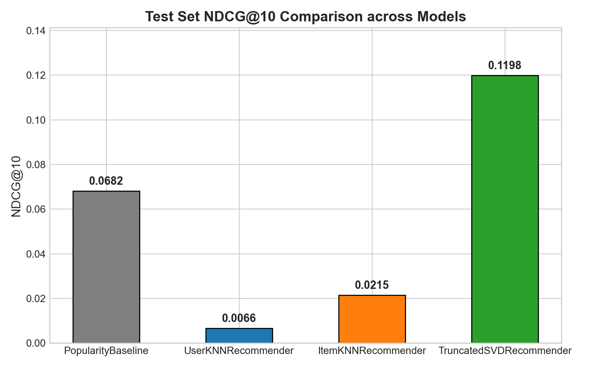
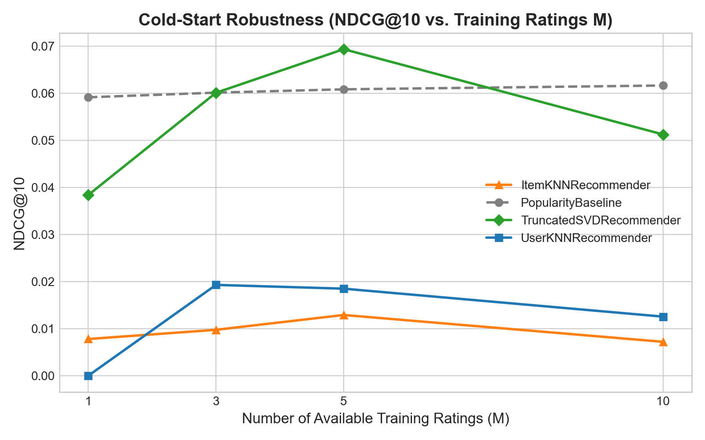

# Collaborative Filtering Movie Recommendation System

[](https://www.python.org/downloads/)
[](https://opensource.org/licenses/MIT)
[]()
[](https://grouplens.org/datasets/movielens/100k/)

An academic-grade, reproducible, and explainable collaborative filtering recommendation system built on the GroupLens MovieLens 100K benchmark (`ml-100k`). Designed for viva defense examination, this project compares canonical collaborative filtering architectures, strictly enforces temporal leakage prevention, evaluates both rating estimation error and top-$N$ ranking utility, and features a production-ready serving layer with an interactive Streamlit web application.

---

## Academic Citation
When referencing this dataset or project, cite the foundational GroupLens research:
> **Harper, F. M., & Konstan, J. A. (2015).** The MovieLens Datasets: History and Context. *ACM Transactions on Interactive Intelligent Systems (TiiS)*, 5(4), Article 19, 1–19. DOI: [10.1145/2827872](https://doi.org/10.1145/2827872).

---

## Table of Contents
1. [Problem Statement & Core Principles](#1-problem-statement--core-principles)
2. [Dataset Provenance & Preprocessing](#2-dataset-provenance--preprocessing)
3. [Collaborative Filtering Model Architectures](#3-collaborative-filtering-model-architectures)
4. [Evaluation Protocol & Mathematical Metrics](#4-evaluation-protocol--mathematical-metrics)
5. [Empirical Results & Benchmark Findings](#5-empirical-results--benchmark-findings)
6. [Cold-Start Analysis & Robustness](#6-cold-start-analysis--robustness)
7. [System Performance & Latency Benchmarks](#7-system-performance--latency-benchmarks)
8. [Interactive Streamlit Web Application](#8-interactive-streamlit-web-application)
9. [Installation & Execution Guide](#9-installation--execution-guide)
10. [Repository Directory Layout](#10-repository-directory-layout)
11. [Limitations & Future Research](#11-limitations--future-research)
12. [Academic References](#12-academic-references)

---

## 1. Problem Statement & Core Principles

Most collaborative filtering tutorials rely on random interaction train/test splits, evaluate solely on Root Mean Squared Error (RMSE), and treat missing values as zeros. In real-world recommendation systems:
1. **Temporal Leakage Distorts Generalization:** Random splits leak future consumption into the training partition, allowing algorithms to predict past ratings using future preferences.
2. **RMSE Does Not Measure Ranking Utility:** RMSE penalizes uniform scale shifts across unconsumed items, whereas users interact exclusively with top-$N$ ranked items.
3. **Unrated Movies Are Missing, Never Zero:** Filling unobserved entries with zeros assumes active negative preference on unconsumed items and destroys sparse matrix efficiency.

This repository implements a rigorous, leakage-free benchmark adhering to three core engineering rules:
- **Pure Collaborative Filtering:** Recommendations are derived strictly from user-item rating interactions ($u, i, r, t$) without external side-information (genres, cast, demographics) contaminating the core CF engine.
- **Strict Chronological Splitting:** A per-user chronological 60/20/20 split preserves the natural arrow of time: $\max(t_{\text{train}}) \le \min(t_{\text{val}}) \le \max(t_{\text{val}}) \le \min(t_{\text{test}})$.
- **Pre-Committed Metric Hierarchy:** Validation NDCG@10 is the primary model-selection metric; RMSE is secondary. The held-out test split is evaluated exactly once on the champion architecture.

---

## 2. Dataset Provenance & Preprocessing

The system utilizes the verified GroupLens MovieLens 100K benchmark (`ml-100k`):
- **Ratings:** 100,000 explicit ratings on a 1–5 integer scale.
- **Users:** 943 unique users (each with at least 20 historical ratings).
- **Movies:** 1,682 unique catalog titles.
- **Sparsity:** $93.70\%$ computed via $\text{Sparsity} = 1 - \frac{|\mathcal{R}|}{|U| \times |I|} = 1 - \frac{100,000}{943 \times 1,682}$.
- **Data Integrity:** Zero duplicate $(u, i)$ pairs, zero null ratings, timestamps bounded between September 1997 and April 1998.

### Per-User Chronological Partitioning
For each user $u \in U$ with interaction count $n_u \ge 20$:
$$n_{\text{train}, u} = \lfloor 0.60 \times n_u \rfloor, \quad n_{\text{val}, u} = \lfloor 0.20 \times n_u \rfloor, \quad n_{\text{test}, u} = n_u - n_{\text{train}, u} - n_{\text{val}, u}$$
- **Training Set (60%):** 59,576 ratings (used for fitting priors, similarity matrices, and latent factors).
- **Validation Set (20%):** 19,676 ratings (used exclusively for hyperparameter tuning and model selection).
- **Held-Out Test Set (20%):** 20,748 ratings (reserved strictly for final one-shot evaluation).
- **Split Boundaries:** Timestamp ties at split boundaries are resolved deterministically using fixed random seed `42`.

---

## 3. Collaborative Filtering Model Architectures

All models subclass `BaseRecommender` and implement the unified interface: `fit(train_ratings)`, `predict(user_id, item_id) -> float`, and `recommend(user_id, n, exclude_seen=True) -> list[tuple[item_id, score]]`.

```
                        ┌──────────────────────────────────────┐
                        │       BaseRecommender Interface      │
                        │  fit() | predict() | recommend()     │
                        └──────────────────┬───────────────────┘
                                           │
         ┌──────────────────┬──────────────┴─────┬──────────────────┐
         ▼                  ▼                    ▼                  ▼
┌──────────────────┐ ┌──────────────┐ ┌──────────────────┐ ┌──────────────────┐
│PopularityBaseline│ │UserKNNRecomm.│ │ItemKNNRecommender│ │TruncatedSVDRecomm│
│ (Bayesian Damped)│ │(User Pearson)│ │ (Adjusted Cosine)│ │ (Latent Factors) │
└──────────────────┘ └──────────────┘ └──────────────────┘ └──────────────────┘
```

### 3.1 Non-Personalized Baseline: Bayesian Damped Mean
Scores items using a shrinkage prior that pulls low-interaction items toward the global dataset mean $\mu$:
$$\hat{r}_i = \frac{\sum_{u \in U_i} r_{ui} + m \cdot \mu}{|U_i| + m}$$
- **Damping Parameter:** $m = 50.0$ (selected via validation tuning).
- **Intuitive Purpose:** Prevents noisy 5-star outlier movies with only 1–2 ratings from dominating top-rank recommendations.

### 3.2 User Memory-Based CF: Pearson Correlation with Mean-Centering
Identifies like-minded peers by evaluating Pearson correlation across co-rated items:
$$s(u, v) = \frac{\sum_{i \in I_{uv}} (r_{ui} - \mu_u)(r_{vi} - \mu_v)}{\sqrt{\sum_{i \in I_{uv}} (r_{ui} - \mu_u)^2} \sqrt{\sum_{i \in I_{uv}} (r_{vi} - \mu_v)^2}}$$
- **Neighborhood Prediction:** Aggregates top-$k$ peers ($k=10$, minimum overlap $= 2$) gated strictly to positive similarities ($s > 0$):
  $$\hat{r}_{ui} = \mu_u + \frac{\sum_{v \in \mathcal{N}_i(u)} s(u, v)(r_{vi} - \mu_v)}{\sum_{v \in \mathcal{N}_i(u)} s(u, v)}$$
- **Deterministic Fallback:** If zero positive neighbors exist: item mean $\mu_i \to$ user mean $\mu_u \to$ global mean $\mu$.

### 3.3 Item Memory-Based CF: Adjusted Cosine Similarity
Evaluates similarity between movie vectors by subtracting user rating baselines $\mu_u$:
$$s(i, j) = \frac{\sum_{u \in U_{ij}} (r_{ui} - \mu_u)(r_{uj} - \mu_u)}{\sqrt{\sum_{u \in U_{ij}} (r_{ui} - \mu_u)^2} \sqrt{\sum_{u \in U_{ij}} (r_{uj} - \mu_u)^2}}$$
- **Inverted Index Optimization:** Constructs an inverted co-rater index during candidate retrieval. Any unrated movie sharing zero co-raters with the user's history mathematically evaluates to zero similarity and directly receives fallback predictions, eliminating redundant $\mathcal{O}(|\mathcal{C}_u| \cdot |I_u|)$ similarity evaluations while preserving 100% exact numerical rankings ($< 10^{-9}$ tolerance).

### 3.4 Latent Factor Matrix Factorization: Truncated SVD Benchmark
Decomposes the mean-centered sparse interaction matrix into rank-$k$ latent concept spaces.
- **Sparse Mean-Centering:** Rather than dense centering, user means are subtracted **only from observed entries**:
  $$\tilde{r}_{ui} = r_{ui} - \mu_u \quad \forall (u, i) \in \Omega_{\text{train}}$$
  Unobserved coordinates remain numerical zeros in SciPy CSR format, avoiding dense materialization of 1.58M floats.
- **Decomposition:** $\tilde{R} \approx U_k \Sigma_k V_k^T$ via `scipy.sparse.linalg.svds` ($n_{\text{factors}}=20$, seed $42$).
- **Prediction:** $\hat{r}_{ui} = \text{clip}(\mu_u + (U_k \Sigma_k V_k^T)_{ui}, 1.0, 5.0)$.

---

## 4. Evaluation Protocol & Mathematical Metrics

### Candidate Space & Binary Relevance
- **Candidate Set:** For user $u$, candidate items for ranking consist of all catalog items unrated in training:
  $$\mathcal{C}_u = I \setminus \text{Seen}_u \quad (|\mathcal{C}_u| \approx 1,500\text{--}1,650 \text{ movies per user})$$
- **Ground Truth Relevance:** A test rating is binary relevant if $r_{ui} \ge 4.0$.
- **Handling Zero-Relevant Users:** Users with no test ratings $\ge 4.0$ have an undefined Ideal DCG ($0.0$). Per protocol, these 25 users are excluded from macro-averaged ranking metrics ($U^* = 918$ evaluated users) and explicitly counted in result tables.

### Metric Formulations
1. **Mean Absolute Error (MAE):** $\text{MAE} = \frac{1}{|\mathcal{T}|} \sum |r_{ui} - \hat{r}_{ui}|$
2. **Root Mean Squared Error (RMSE):** $\text{RMSE} = \sqrt{\frac{1}{|\mathcal{T}|} \sum (r_{ui} - \hat{r}_{ui})^2}$
3. **Precision@K:** $\text{Precision@K} = \frac{1}{|U^*|} \sum_{u \in U^*} \frac{|\text{Rec}_K(u) \cap \text{Rel}_u|}{K}$
4. **Recall@K:** $\text{Recall@K} = \frac{1}{|U^*|} \sum_{u \in U^*} \frac{|\text{Rec}_K(u) \cap \text{Rel}_u|}{|\text{Rel}_u|}$
5. **NDCG@K:** $\text{NDCG@K} = \frac{1}{|U^*|} \sum_{u \in U^*} \frac{\text{DCG@K}(u)}{\text{IDCG@K}(u)}$ where $\text{DCG@K}(u) = \sum_{m=1}^K \frac{2^{\text{rel}_m} - 1}{\log_2(m + 1)}$
6. **Catalog Coverage@K:** $\text{Coverage@K} = \frac{|\bigcup_{u} \text{Rec}_K(u)|}{|I|}$
7. **Novelty@K:** $\text{Novelty@K} = \frac{1}{|U| \cdot K} \sum_{u} \sum_{i \in \text{Rec}_K(u)} -\log_2 P(i)$

---

## 5. Empirical Results & Benchmark Findings

### 5.1 Validation Hyperparameter Tuning Summary
Hyperparameter tuning was conducted exclusively on the validation split (`results/validation_tuning.csv`, 32 configurations). Models were pre-committed based on **Validation NDCG@10**:

| Model Family | Search Grid | Selected Configuration | Val NDCG@10 | Val RMSE |
| :--- | :--- | :--- | :---: | :---: |
| **PopularityBaseline** | `damping` $\in [0, 50]$, `min_ratings` $\in [1, 10]$ | `damping=50.0, min_ratings=1` | 0.0702 | 1.0404 |
| **UserKNNRecommender** | $k \in [10, 30]$, `min_overlap` $\in [1, 2]$ | $k=10, \text{min\_overlap}=2$ | 0.0050 | 0.9985 |
| **ItemKNNRecommender** | $k \in [10, 30]$, `min_overlap` $\in [1, 2]$ | $k=10, \text{min\_overlap}=1$ | 0.0050 | 1.0832 |
| **TruncatedSVDRecommender** | $n_{\text{factors}} \in [5, 50]$ | **$n_{\text{factors}}=20, \text{seed}=42$ (Winner)** | **0.1138** | 1.0407 |

### 5.2 Held-Out Final Test Evaluation Results
Selected models were refitted on `Train + Validation` (79,252 ratings) and evaluated once on the held-out `Test` split (20,748 ratings) via the logged `--final` flag:

| Model | Config | NDCG@10 | Precision@10 | Recall@10 | RMSE | MAE | Catalog Coverage@10 | Novelty@10 |
| :--- | :--- | :---: | :---: | :---: | :---: | :---: | :---: | :---: |
| **TruncatedSVDRecommender** | `n_factors=20` | **0.1198** | **0.0914** | **0.0902** | 1.1028 | 0.8735 | 20.69% | 3.5555 |
| **PopularityBaseline** | `damping=50.0` | 0.0682 | 0.0593 | 0.0511 | 1.1189 | 0.9088 | 3.80% | 3.6090 |
| **ItemKNNRecommender** | `k=10, overlap=1` | 0.0215 | 0.0210 | 0.0139 | 1.1177 | 0.8851 | **76.34%** | 8.0758 |
| **UserKNNRecommender** | `k=10, overlap=2` | 0.0066 | 0.0057 | 0.0040 | **1.0184** | **0.8027** | 22.47% | **8.8244** |



### 5.3 Critical Insight: The RMSE vs. Ranking Divergence
- **UserKNN** won on RMSE (**1.0184**), but failed on Top-$N$ ranking (NDCG@10 = **0.0066**). Under $93.7\%$ sparsity, finding overlapping neighbors for $1,600$ unrated candidates is rare; the model collapses to user-mean baseline ties.
- **Truncated SVD** dominated Top-$N$ ranking (**0.1198**), despite a higher RMSE (**1.1028**). SVD projects sparse profiles into dense concept spaces, accurately capturing relative preference orderings across unrated movies.
- **ItemKNN** serves as the **Discovery Engine**: While achieving lower top-10 precision, it achieved an extraordinary **76.34% Catalog Coverage**, recommending long-tail items rather than recycling blockbusters.

---

## 6. Cold-Start Analysis & Robustness

To measure degradation under severe profile sparsity, training histories were truncated to $M \in \{1, 3, 5, 10\}$ ratings (`results/cold_start_experiment.csv`):

| Available Ratings ($M$) | Metric | PopularityBaseline | UserKNN | ItemKNN | TruncatedSVD |
| :---: | :--- | :---: | :---: | :---: | :---: |
| **$M = 1$ (Extreme Cold-Start)** | NDCG@10 | **0.0592** | 0.0000 | 0.0078 | 0.0384 |
| | Recall@10 | **0.0503** | 0.0000 | 0.0072 | 0.0329 |
| | RMSE | 1.0470 | **1.0445** | 1.2150 | 1.4552 |
| **$M = 3$** | NDCG@10 | **0.0601** | 0.0193 | 0.0098 | **0.0601** |
| | Recall@10 | 0.0511 | 0.0166 | 0.0108 | **0.0512** |
| | RMSE | **1.0470** | 1.2047 | 1.2593 | 1.2453 |
| **$M = 5$** | NDCG@10 | 0.0608 | 0.0185 | 0.0129 | **0.0694** |
| | Recall@10 | 0.0511 | 0.0144 | 0.0129 | **0.0843** |
| | RMSE | **1.0470** | 1.1502 | 1.2209 | 1.1627 |
| **$M = 10$** | NDCG@10 | **0.0617** | 0.0126 | 0.0072 | 0.0513 |
| | Recall@10 | **0.0523** | 0.0060 | 0.0044 | 0.0497 |
| | RMSE | **1.0469** | 1.0627 | 1.1371 | 1.0846 |



**Architectural Takeaway:** Popularity Baseline provides the essential cold-start safety net for $M < 3$. At $M \ge 3$, SVD aligns with the user's latent preferences and takes over.

---

## 7. System Performance & Latency Benchmarks

All figures represent actual measured wall-clock execution time and peak memory traced via `tracemalloc` on Windows 11 (Python 3.11.9):

| Pipeline Stage | Scope | Measured Latency | Peak Memory |
| :--- | :--- | :---: | :---: |
| **Data Ingestion & Splitting** | 100K ratings $\to$ 60/20/20 per-user | 2.79 s | 30.36 MB |
| **Popularity Baseline Fit** | 79,252 ratings | 222.09 ms | 10.78 MB |
| **Truncated SVD Fit ($k=20$)** | 79,252 ratings, sparse CSR | 633.71 ms | 12.75 MB |
| **User-based kNN Fit** | 79,252 ratings | 7.30 s | 17.99 MB |
| **Item-based kNN Fit** | 79,252 ratings | 6.91 s | 22.60 MB |
| **SVD Known User Recommendation** | Per user ($N=10$, unseen catalog) | 1.66 ms | < 1 MB |
| **Service Online SVD Folding-In** | Per request (arbitrary new profile) | **2.86 ms** | < 1 MB |

---

## 8. Interactive Streamlit Web Application

The project includes an interactive web application (`app/streamlit_app.py`) for viva demonstrations:

### Key Application Features
1. **Interactive Profile Builder:** Search 1,682 movies by title, assign 1–5 star ratings, and receive real-time collaborative filtering recommendations.
2. **Transparent Cold-Start Badge:** Profiles with $< 3$ ratings display a warning badge indicating Popularity Baseline fallback; adding a 3rd rating dynamically transitions to personalized SVD folding-in.
3. **Grounded Model Explanations:** Explanations cite the user's positively rated movie ($r \ge 3.0$) with the highest positive cosine similarity ($s > 0.10$) in SVD latent space (e.g. *Recommended because you rated 'Star Wars (1977)' 5.0 stars (similarity: 0.85)*).
4. **Historical User Inspector:** Inspect recommendations for any training user ($1..943$).
5. **Movie Similarity Explorer:** Query any catalog movie to view its top latent factor cosine neighbors (e.g. *Toy Story* $\to$ *Beauty and the Beast*, *The Lion King*, *Aladdin*).
6. **Pure HTML/CSS Table Rendering:** Eliminates binary pyarrow ABI incompatibilities while ensuring safe string escaping (`escape=True`) against XSS.

---

## 9. Installation & Execution Guide

### Prerequisites
- Python 3.10+ (Python 3.11 recommended).
- Git (optional).

### Step 1: Create Virtual Environment
```powershell
python -m venv .venv
.\.venv\Scripts\Activate.ps1
```

### Step 2: Install Pinned Dependencies
```powershell
pip install -r requirements.txt
```

### Step 3: Download & Verify Dataset
```powershell
python scripts/download_data.py
```

### Step 4: Run the Complete Automated Test Suite (53 Tests)
```powershell
& ".\.venv\Scripts\pytest.exe" -v
```

### Step 5: Launch the Streamlit Web Application
```powershell
& ".\.venv\Scripts\streamlit.exe" run app/streamlit_app.py
```
*Access the interactive interface at `http://localhost:8501`.*

### Step 6: Reproduce Evaluation & Benchmark Runs
```powershell
$env:MPLCONFIGDIR = "$env:LOCALAPPDATA\Temp\matplotlib"; & ".\.venv\Scripts\python.exe" -u scripts/run_evaluation.py --final
```

---

## 10. Repository Directory Layout

```
MOVIE RECOMMENDATION PROJECT/
├── .gitignore                      # GroupLens dataset and artifact exclusion
├── PROJECT_STATUS.md               # Authoritative phase tracking and audit verdicts
├── README.md                       # Master system documentation
├── requirements.txt                # Pinned dependency manifest
├── RULES.md                        # Binding phase-gate governance and constraints
├── app/
│   └── streamlit_app.py            # Streamlit multi-mode web application
├── data/                           # (Gitignored) GroupLens raw and processed files
│   └── raw/ml-100k/                # Extracted MovieLens dataset files (u.data, u.item)
├── docs/
│   ├── architecture.md             # System architectural blueprints
│   ├── data_quality_report.md      # Dataset ingestion and EDA report
│   ├── decisions.md                # Chronological architectural decision log
│   ├── evaluation_protocol.md      # Mathematical evaluation protocol
│   ├── evaluation_results.md       # Empirical results and trade-off analysis
│   ├── final_readiness_report.md   # Feature checklist and submission manifest
│   ├── models.md                   # Algorithm derivations and toy matrix proofs
│   ├── service_interface.md        # Public API contract for RecommenderService
│   ├── spec.md                     # Engineering specification
│   ├── viva_prep.md                # 16-question viva defense interview guide
│   ├── audits/                     # Independent phase audit records (Phases 0–5)
│   ├── phases/                     # Formal phase task specifications
│   └── reports/                    # Formal phase completion reports (Phases 0–5)
├── results/
│   ├── cold_start_experiment.csv   # Cold-start interaction truncation results
│   ├── final_run.log               # One-shot final test evaluation audit trail
│   ├── test_evaluation_results.csv # Final held-out test evaluation metrics
│   ├── validation_tuning.csv       # 32-configuration hyperparameter search grid
│   ├── artifacts/                  # Serialized models (SVD, Popularity)
│   ├── eda/                        # 5 Exploratory data analysis figures
│   └── plots/                      # Evaluation comparison and cold-start figures
├── scripts/
│   ├── download_data.py            # Dataset acquisition and SHA-256 verification
│   ├── run_eda.py                  # Exploratory data analysis generation
│   └── run_evaluation.py           # Evaluation, tuning, and benchmark orchestration
└── tests/
    ├── conftest.py                 # Pytest root configuration
    ├── integration/                # End-to-end and leakage integration tests
    │   ├── test_end_to_end.py
    │   └── test_leakage.py
    └── unit/                       # Unit tests across components (51 tests)
        ├── test_app.py
        ├── test_data.py
        ├── test_evaluation.py
        ├── test_models.py
        ├── test_service.py
        └── test_split.py
```

---

## 11. Limitations & Future Research

1. **Missing-Not-At-Random (MNAR) Selection Bias:**
   In MovieLens, users choose which movies to rate based on marketing and prior preference. True negative ratings for unobserved items cannot be definitively known from offline data.
2. **Popularity Bias:**
   Offline top-$N$ metrics favor models recommending blockbuster titles that frequently appear in held-out test sets, penalizing serendipitous long-tail recommendations.
3. **Scaling Beyond 100K Interactions:**
   While Truncated SVD scales comfortably on sparse CSR matrices ($\mathcal{O}(k \cdot |\Omega|)$), industrial scale ($10^7\text{--}10^9$ interactions) necessitates transition to Alternating Least Squares (ALS) with implicit feedback or Two-Tower Neural Embeddings paired with approximate nearest neighbor vector indexing (FAISS / ScaNN).

---

## 12. Academic References

1. **Cremonesi, P., Koren, Y., & Turrin, R. (2010).** Performance of Recommender Algorithms on Top-N Recommendation Tasks. In *Proceedings of the fourth ACM conference on Recommender systems (RecSys '10)*, 39–46. DOI: [10.1145/1864708.1864721](https://doi.org/10.1145/1864708.1864721).
2. **Deerwester, S., Dumais, S. T., Furnas, G. W., Landauer, T. K., & Harshman, R. (1990).** Indexing by Latent Semantic Analysis. *Journal of the American Society for Information Science*, 41(6), 391–407.
3. **Harper, F. M., & Konstan, J. A. (2015).** The MovieLens Datasets: History and Context. *ACM Transactions on Interactive Intelligent Systems (TiiS)*, 5(4), 1–19. DOI: [10.1145/2827872](https://doi.org/10.1145/2827872).
4. **Järvelin, K., & Kekäläinen, J. (2002).** Cumulated Gain-Based Evaluation of IR Techniques. *ACM Transactions on Information Systems (TOIS)*, 20(4), 422–446. DOI: [10.1145/582415.582418](https://doi.org/10.1145/582415.582418).
5. **Koren, Y., Bell, R., & Volinsky, C. (2009).** Matrix Factorization Techniques for Recommender Systems. *Computer*, 42(8), 30–37. DOI: [10.1109/MC.2009.263](https://doi.org/10.1109/MC.2009.263).
6. **Sarwar, B., Karypis, G., Konstan, J., & Riedl, J. (2001).** Item-Based Collaborative Filtering Recommendation Algorithms. In *Proceedings of the 10th international conference on World Wide Web (WWW '01)*, 285–295. DOI: [10.1145/371920.372071](https://doi.org/10.1145/371920.372071).
