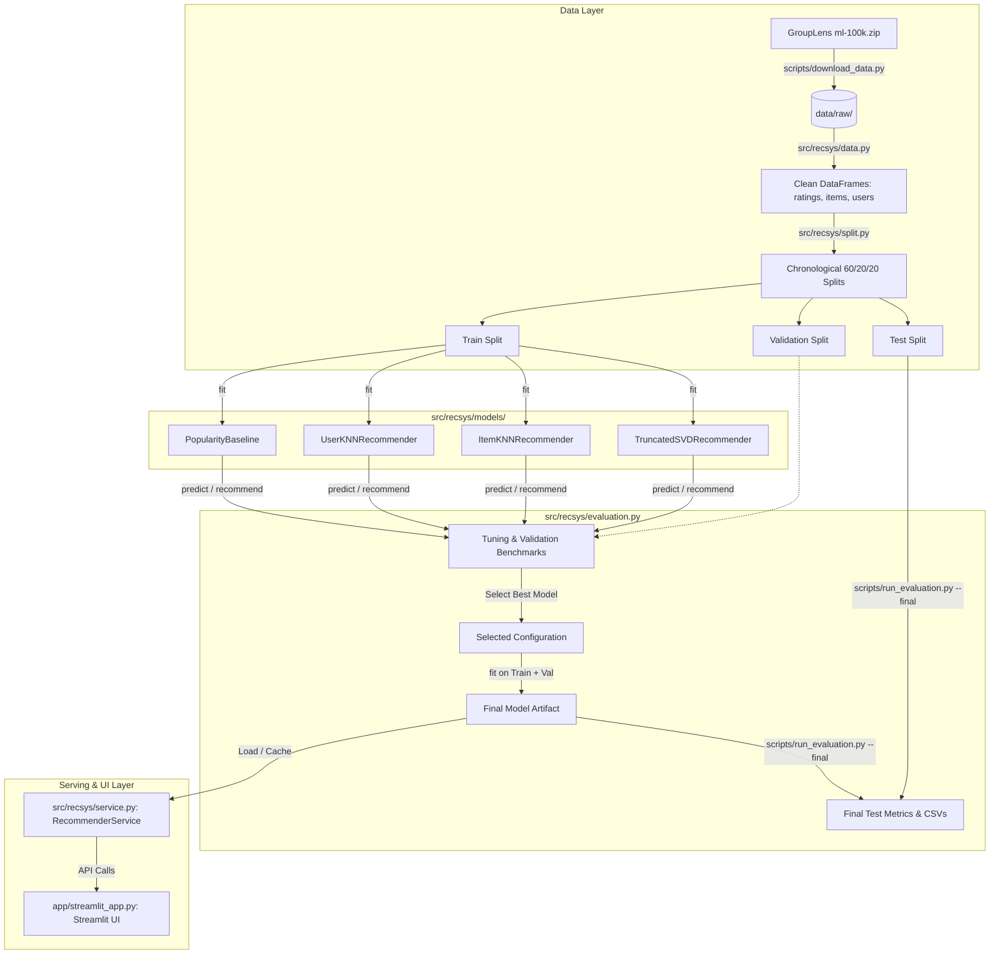

# System Architecture: Movie Recommendation System

## 1. Architectural Overview
The system follows a clean, modular architecture separating data ingestion, partitioning, model training, evaluation, service coordination, and the presentation layer.

---

## 2. Module Breakdown & Responsibilities

| Directory / File | Core Responsibility |
|---|---|
| `scripts/download_data.py` | Downloads `ml-100k.zip`, extracts raw files, verifies checksum/structure, configures `.gitignore`. |
| `scripts/run_eda.py` | Generates summary statistics and at least 5 EDA plots (long-tail, sparsity, rating distributions). |
| `scripts/run_evaluation.py` | Orchestrates model validation tuning, logs metrics, and executes the final test run under `--final`. |
| `src/recsys/data.py` | Ingests `u.data`, `u.item`, `u.user` into pandas DataFrames, maps entity IDs to contiguous indices, validates schema. |
| `src/recsys/split.py` | Implements per-user chronological partitioning (60% train / 20% validation / 20% test). |
| `src/recsys/models/base.py` | Abstract Base Class defining the unified recommender interface. |
| `src/recsys/models/popularity.py` | Damped mean popularity model with global prior. |
| `src/recsys/models/user_knn.py` | User-based collaborative filtering using Pearson correlation with mean-centering. |
| `src/recsys/models/item_knn.py` | Item-based collaborative filtering using adjusted cosine similarity. |
| `src/recsys/models/svd.py` | Truncated SVD benchmark decomposing sparse user-mean-centred ratings. |
| `src/recsys/evaluation.py` | Metrics library: MAE, RMSE, Precision@K, Recall@K, NDCG@K, Coverage, Diversity. |
| `src/recsys/service.py` | High-level `RecommenderService` wrapping models, caching, cold-start logic, and profile updates. |
| `app/streamlit_app.py` | Interactive web frontend for movie browsing, ratings input, recommendation, and explanation. |
| `tests/` | Unit, integration, invariant, and `AppTest` test suites across all modules. |

---

## 3. Common Model Interface

All models in `src/recsys/models/` inherit from `BaseRecommender` and strictly adhere to three methods:

### 3.1 `fit(train_ratings: pd.DataFrame) -> "BaseRecommender"`
- **Input:** DataFrame containing `[user_id, item_id, rating, timestamp]`.
- **Contract:**
  - Computes all parameters, entity means, similarities, and decomposition components solely from `train_ratings`.
  - Builds sparse matrix structures (SciPy CSR) with internal 0-indexed integer ID mappers.
  - Returns `self` for fluent chaining.

### 3.2 `predict(user_id: int, item_id: int) -> float`
- **Input:** External `user_id` and `item_id`.
- **Contract:**
  - Returns estimated rating $\hat{r}_{u, i}$ bounded in $[1.0, 5.0]$.
  - Executes deterministic fallback chain if data is insufficient:
    $$\hat{r}_{u, i} = \text{Model Prediction} \longrightarrow \mu_i \text{ (item mean)} \longrightarrow \mu_u \text{ (user mean)} \longrightarrow \mu \text{ (global mean)}$$
  - Handles unknown users or unknown items gracefully by falling back down the chain.

### 3.3 `recommend(user_id: int, n: int = 10, exclude_seen: bool = True) -> list[tuple[int, float]]`
- **Input:** `user_id`, candidate count $n$, boolean flag `exclude_seen`.
- **Contract:**
  - Candidates: All movies the user has not rated in training (when `exclude_seen=True`).
  - Returns top-$n$ tuples of `(item_id, predicted_score)` ordered descending by score.
  - If `user_id` has no rating history (cold-start), falls back cleanly to popularity ranking.

---

## 4. Sparse Matrix & Mathematical Representation

### 4.1 Missingness vs. Zero
- An unrated item is missing (unobserved), never an explicit 0 rating.
- In SciPy CSR matrix $R \in \mathbb{R}^{|U| \times |I|}$, stored values represent explicit ratings $r_{u, i} \in [1, 5]$. Coordinates not in matrix data are unobserved.

### 4.2 Handling SVD Without Full Dense Materialization
- Subtracting user mean $\mu_u$ across all unrated items would turn a $93.7\%$ sparse matrix dense ($943 \times 1,682 = 1.58 \times 10^6$ floats), which violates sparsity best practices.
- For `scipy.sparse.linalg.svds`, we mean-centre observed entries:
  $$\tilde{r}_{u, i} = r_{u, i} - \mu_u \quad \forall (u, i) \in \Omega_{\text{train}}$$
  leaving unobserved entries as 0 (which represents the user's average rating in mean-centred space).
- The rank-$k$ truncated SVD decomposes $\tilde{R} \approx U_k \Sigma_k V_k^T$.
- Rating reconstruction:
  $$\hat{r}_{u, i} = \mu_u + (U_k \Sigma_k V_k^T)_{u, i}$$
  clipped to $[1.0, 5.0]$.

---

## 5. Service & UI Integration Layer

### 5.1 `RecommenderService` (`src/recsys/service.py`)
- **Lifecycle:** Instantiates and holds fitted model artifacts and movie metadata in memory.
- **Methods:**
  - `recommend_for_user(user_id, n, filter_genres)`: Direct lookup for existing users.
  - `recommend_for_profile(ratings_dict, n, filter_genres)`: Folds an interactive user profile into the recommender without full model refitting.
  - `similar_movies(item_id, n)`: Computes item-item similarity vectors.
  - `search_movies(query)`: Fuzzy or substring match against movie titles.
- **Cold-Start Handling:** If an ad-hoc profile contains fewer than $N_{\text{min}}$ (e.g., 3) ratings, automatically returns top popularity recommendations with explicit metadata tag `is_cold_start=True`.

### 5.2 Streamlit Web Application (`app/streamlit_app.py`)
- Provides an intuitive interface for viva examination and real-time interaction:
  - Sidebar: Filter genres, choose top-$N$ ($5, 10, 20$), select active model.
  - Main Panel: Search and rate movies on a 1–5 star scale.
  - Recommendation Table: Displays Title, Release Year, Genres, Predicted Score / Average Rating.
  - Explanation Drawer: Highlights top-contributing rated movies that influenced each recommendation based on similarity weights.
