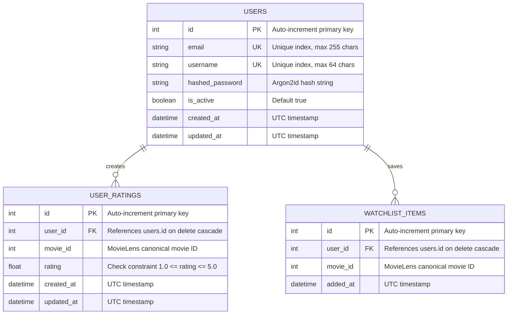

# Database Schema Documentation — MovieRec Version 2

MovieRec Version 2 utilizes an explicit relational schema implemented in **SQLAlchemy 2.0** (`v2/backend/app/db/models.py`). While SQLite is used for lightweight local execution, all column constraints, foreign keys, and indexes are fully compatible with production PostgreSQL deployments.

---

## 1. Entity-Relationship Diagram

---

## 2. Table Specifications

### 2.1 `users` Table
Stores registered website user accounts. **Note:** User accounts are completely segregated from historical MovieLens persona IDs ($1 \dots 6,040$).

| Column Name | Data Type | Constraints | Description |
| :--- | :--- | :--- | :--- |
| `id` | `INTEGER` | Primary Key, Auto-increment | Unique identifier for registered user. |
| `email` | `VARCHAR(255)` | Unique, Not Null, Indexed | User login email address (case-normalized). |
| `username` | `VARCHAR(64)` | Unique, Not Null, Indexed | Public display handle. |
| `hashed_password` | `VARCHAR(255)` | Not Null | Cryptographic password hash generated via Argon2id. |
| `is_active` | `BOOLEAN` | Not Null, Default `True` | Account status flag. |
| `created_at` | `DATETIME` | Not Null, Default `UTC NOW` | Timestamp of account registration. |
| `updated_at` | `DATETIME` | Nullable | Timestamp of last profile update. |

---

### 2.2 `user_ratings` Table
Stores individual movie rating interactions submitted by registered users. Used as the input vector for real-time SVD latent factor folding-in.

| Column Name | Data Type | Constraints | Description |
| :--- | :--- | :--- | :--- |
| `id` | `INTEGER` | Primary Key, Auto-increment | Rating event ID. |
| `user_id` | `INTEGER` | Foreign Key (`users.id`), Indexed | Target user reference (ON DELETE CASCADE). |
| `movie_id` | `INTEGER` | Not Null, Indexed | Canonical MovieLens 1M movie ID. |
| `rating` | `FLOAT` | Not Null, Check `1.0 <= rating <= 5.0` | Rating score in stars. |
| `created_at` | `DATETIME` | Not Null, Default `UTC NOW` | Timestamp when rating was submitted. |
| `updated_at` | `DATETIME` | Nullable | Timestamp of rating modification. |

**Indexes & Unique Constraints:**
- `UniqueConstraint("user_id", "movie_id", name="uq_user_movie_rating")`: Guarantees a user cannot have duplicate rating rows for the same movie; rating updates overwrite in place.

---

### 2.3 `watchlist_items` Table
Stores user bookmarked movies for future viewing.

| Column Name | Data Type | Constraints | Description |
| :--- | :--- | :--- | :--- |
| `id` | `INTEGER` | Primary Key, Auto-increment | Watchlist record ID. |
| `user_id` | `INTEGER` | Foreign Key (`users.id`), Indexed | Owner user account reference (ON DELETE CASCADE). |
| `movie_id` | `INTEGER` | Not Null, Indexed | Canonical MovieLens 1M movie ID. |
| `added_at` | `DATETIME` | Not Null, Default `UTC NOW` | Timestamp added to watchlist. |

**Indexes & Unique Constraints:**
- `UniqueConstraint("user_id", "movie_id", name="uq_user_movie_watchlist")`: Prevents duplicate entries in a user's watchlist.

---

## 3. Data Integrity & Ownership Rules

1. **User Isolation:** All rating and watchlist queries filter strictly by `user_id == current_user.id`. A user cannot read, update, or delete any record where `user_id` differs from their authenticated session.
2. **Cascade Deletions:** If a user account is deleted, all associated `user_ratings` and `watchlist_items` are removed automatically via database foreign key cascading.
3. **Password Confidentiality:** Plaintext passwords are never persisted. Only the salted Argon2id digest string (`$argon2id$v=19$m=65536,t=3,p=4$...`) is stored.
